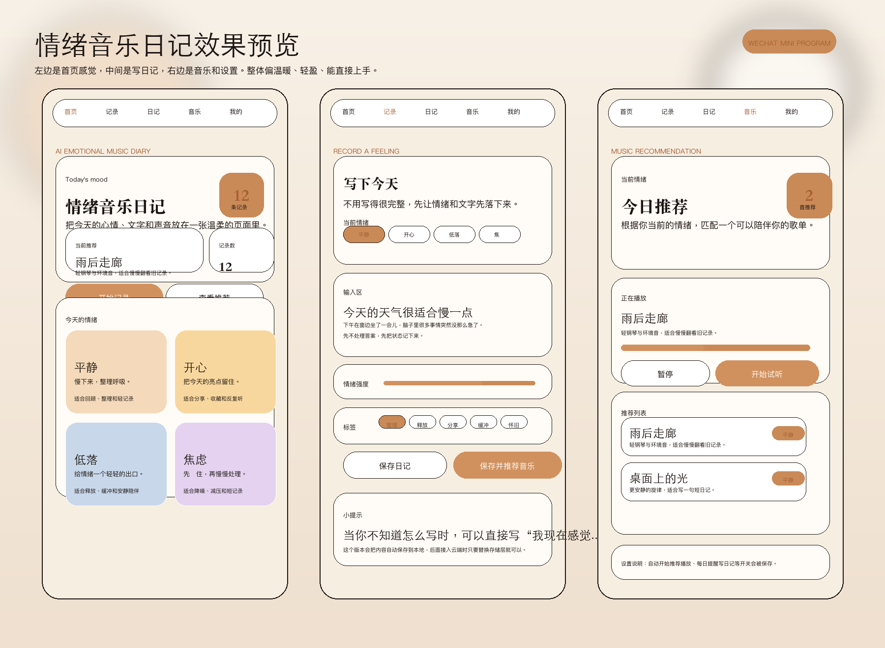

# Life Soundtrack · 情绪音乐日记

一个微信小程序原型：用户主动写下当下的情绪与事件，系统把这段记录转化为可判断、可修改、可保存或删除的歌词与音乐结果。

这个仓库展示的是 CREATE 能力：从用户问题、产品定义和交互原型，推进到分层的小程序 Demo 与云函数工程方案。它不是生产部署证明，也不把 Demo 数据、云端方案和目标用户验证混写成同一件事。

## 招聘者先看

- 问题：文字日记能保存事件，但不一定能形成更有情绪记忆点的表达；产品尝试把“记录”变成用户可以判断和校准的音乐结果。
- 我的工作：梳理记录 → 生成 → 判断 → 调整 → 保存/私密/删除的核心任务；将 UI、用例编排、领域规则、本地状态、云端适配和云函数拆层；补齐失败、私密和不保留边界。
- 关键决策：AI 是转化工具，不替用户判断情绪；生成结果先进入待确认状态；Demo 数据通过单一入口进入运行时；真实密钥只在云函数环境变量中提供。
- 代码阅读入口：`UI/`、`Features/`、`Core/`、`Services/`、`cloudfunctions/`、`Tests/`。
- 设计依据与假设：[`Docs/DESIGN_BASIS.md`](Docs/DESIGN_BASIS.md)。

## 结构

```text
UI/             页面与可复用组件
Features/       创作、歌单、播放用例编排
Core/           状态模型、迁移与领域规则
Services/       AI、云调用、歌曲和任务仓储适配
cloudfunctions/ 微信云函数入口
data/           明确隔离的演示数据入口
assets/         精选图标与插画素材
Tests/          Core、领域逻辑和服务契约测试
scripts/        本地静态检查
Docs/           公开架构、设计依据与验证边界说明
```

完整数据流见 [`Docs/ARCHITECTURE.md`](Docs/ARCHITECTURE.md)。

## 产品界面证据



这张图是源工程已有的静态预览，展示首页、记录页和音乐页的结构关系：先记录情绪与事件，再进入结果和播放/保存场景。它不是微信开发者工具或真机截图，不能证明真实运行；来源与隐私检查见 [`Docs/evidence/INTERFACE_EVIDENCE.md`](Docs/evidence/INTERFACE_EVIDENCE.md)。

## 如何运行

### 只跑本地逻辑检查

需要 Node.js：

```bash
npm test
npm run check
```

### 在微信开发者工具中打开

1. `.env.example` 仅是变量名清单；本工程没有 dotenv 读取机制，不能靠复制它自动注入运行时配置。
2. 在 `config/app-config.js` 中把 `cloudEnv` 改为自己的云开发环境，并选择 `demo` 或 `demo-with-cloud`。
3. 用微信开发者工具导入本仓库根目录，填写自己的 AppID；`project.config.json` 中的 AppID 仅为占位符。
4. 需要云端能力时，按对应云函数目录的 `package.json` 安装部署依赖，并在微信云函数控制台或部署环境中配置 `MINIMAX_API_KEY`、腾讯云 SCF 调用变量等；变量名可参考 `.env.example`，真实值不写入小程序代码或仓库。

云端生成依赖 MiniMax 音乐接口、微信云存储和异步任务触发配置；本仓库不携带任何真实凭证。

## 当前验证边界

已验证：源码副本可进行 Node 语法/JSON/本地模块引用检查；领域测试覆盖状态迁移、歌曲操作、生成任务和云调用契约。

未在本公开包中宣称：真实云端部署成功、真实音频生成和播放、微信真机端到端闭环、目标用户测试、生产发布或审核通过。当前工程记录仍将这些事项标为待环境或真机验证。

## 版本与来源

公开包版本：`life-soundtrack_CREATE_2026-10-19_R01`。

这是从本地 Life Soundtrack 小程序工程精选出的公开副本；研究原件、访谈、个人资料、案例 HTML、含个人信息的截图与本机工程历史不在仓库中。无单独第三方许可证文件随源工程提供，因此本包不新增或推断授权声明；使用者应在再分发前自行核对素材来源与授权。
